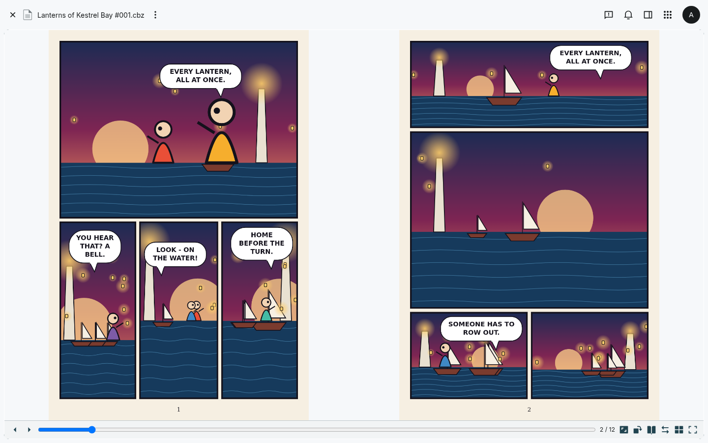
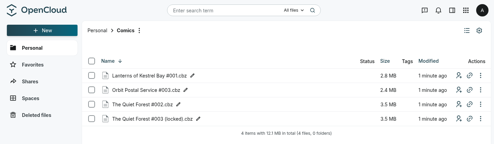
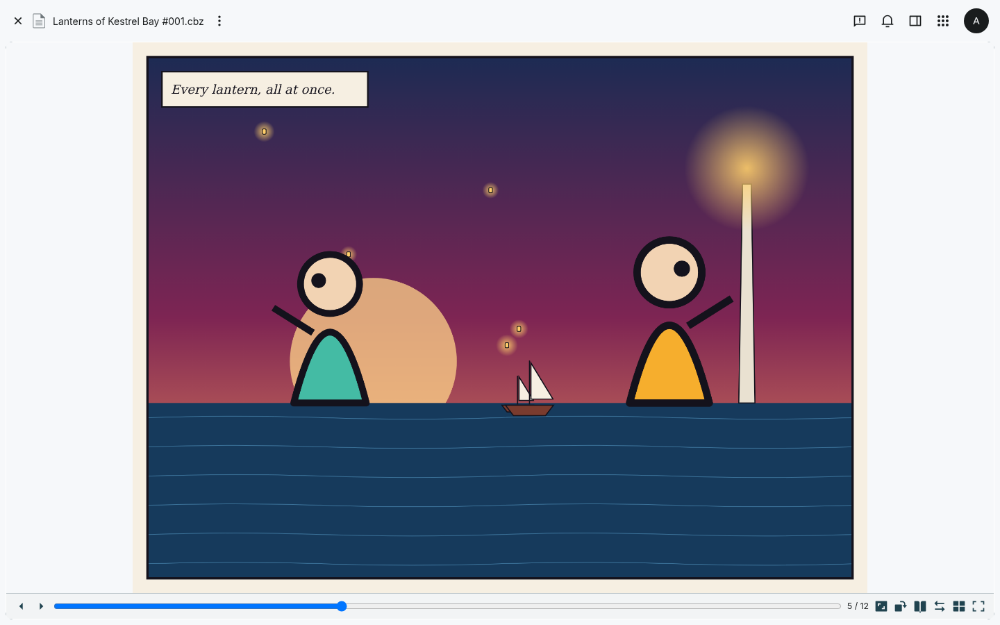
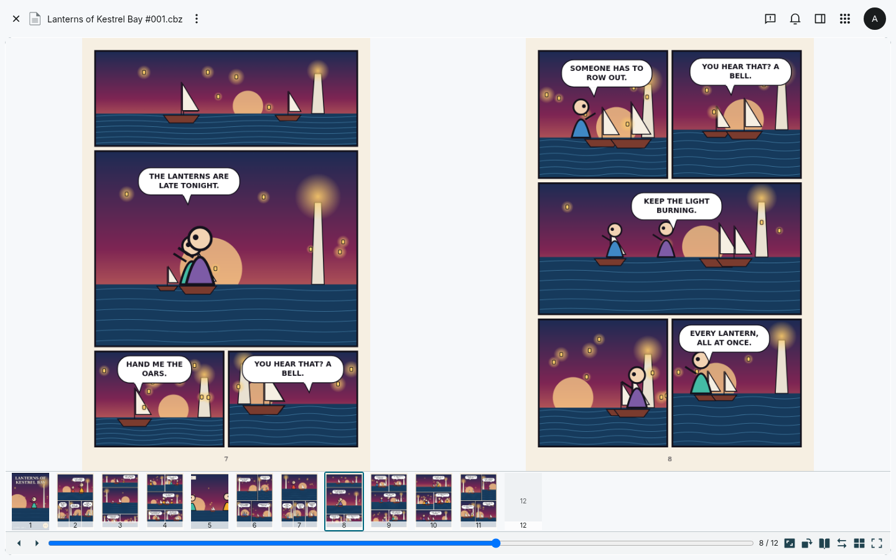
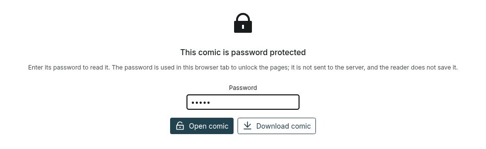

# Comic Reader for OpenCloud Web

Opens `.cbz`, `.cbr`, `.cb7` and `.c7z` comic archives directly in the
OpenCloud file manager. Click a comic, it opens in a reader.

**[Try the live demo](https://comicreader.gaijin.systems)**: the real reader,
running in your browser on a few made-up comics. Nothing to install.

Free software under the GNU AGPL, version 3 or later. See [Licence](#licence).



| | |
| --- | --- |
|  |  |
| Comics are ordinary files in OpenCloud. Clicking one opens the reader. | A spread is shown on its own, across the width. |
|  |  |
| The page strip, for jumping anywhere in the book. | Password-protected comics ask for the password, which stays in the browser tab. |

The comics in these pictures and in the demo are made up for them.

## What is in this repository

```
source/                   The app: build, test, modify.
docs/                     Changelog and solid-RAR notes, plus the original
                          plan, marked as historical at the top. The
                          layout harness is with the source, in
                          source/web-app-comic-reader/docs/.
testfiles/                Test comics. See testfiles/README.txt.
  test-comic.*            Six labelled pages, one file per format.
  formats/                Compression matrix: zip store/deflate/deflate64 plus
                          three zip.js cannot decode; RAR4 and RAR5, each
                          stored, compressed and solid; 7z LZMA1, LZMA2 solid
                          and non-solid, BCJ2, PPMd. Also twelve
                          password-protected files (password "comic"),
                          in every format: each must ask for the password
                          and open with it.
```

Each [release](https://github.com/GaijinSystems/opencloud-comicreader/releases)
has the app ready to install, built from the tagged source by this
repository's workflow (`.github/workflows/release.yml`). Or build it yourself
from this source, decoders included, with two commands and a few minutes. The
first step below covers both. There are no binaries on this branch. (The
`gh-pages` branch holds the live demo, a site built from this source.)

Check which build is deployed with:

    docker compose exec opencloud cat \
      /var/lib/opencloud/web/assets/apps/comic-reader/manifest.json

The `version` and `build` fields identify it. The build is the date it was
made and a hash of its code, in the form `2026-11-13+a1B2c3D4`.

## Quick start

Comic Reader needs OpenCloud 6.0.0 or newer.

**1. Get the app**

Download `comic-reader-<version>.tar.gz` and its `.sha256` file from the
[latest release](https://github.com/GaijinSystems/opencloud-comicreader/releases/latest),
check the download, and unpack it:

    sha256sum -c comic-reader-1.2.2.tar.gz.sha256
    tar -xzf comic-reader-1.2.2.tar.gz

That gives a folder named `comic-reader`, which is the app. Its `SHA256SUMS`
lists the hash of every other file in it, for checking an installed copy
later.

Or build it yourself. You need podman (docker works the same way) and curl.
Nothing else has to be installed.

First build the three WebAssembly decoders. This compiles unarr, libarchive
and 7-Zip's 7z reader from source in an Emscripten container; the libarchive
and 7-Zip sources are downloaded once and checked against recorded hashes:

    cd source/web-app-comic-reader
    sh scripts/build-unarr.sh
    sh scripts/build-libarchive.sh
    sh scripts/build-sevenzip.sh

Then build the app itself:

    mkdir -p dist
    podman run --rm -v "$PWD":/src:ro -v "$PWD/dist":/out \
        docker.io/library/node@sha256:a34ab6d7f6f4813f4d0c5469d74685604b962fbdbf5793a7bc7b4998ecb867c8 \
        sh -c 'cp -a /src/. /tmp/app && cd /tmp/app && rm -rf dist &&
               npm ci --legacy-peer-deps && npm run build && cp -r dist/. /out/'

Or, with Node installed: `npm ci --legacy-peer-deps && npm run build`. Either
way the app is now in `dist/`.

**2. Install it**

Copy the app (the release's `comic-reader` folder, or `dist/`) into
OpenCloud's web app directory as a folder named `comic-reader`, so that
`comic-reader/manifest.json` sits at the top level of the apps directory.

With opencloud-compose the host path is `config/opencloud/apps/`; the compose
file bind-mounts it to `/var/lib/opencloud/web/assets/apps` inside the
container. Do *not* use `$OC_DATA_DIR/web/assets/apps` under compose — the
apps mount is layered on top of the data dir and will shadow it.

    cp -r comic-reader /path/to/opencloud-compose/config/opencloud/apps/   # a release
    cp -r dist /path/to/opencloud-compose/config/opencloud/apps/comic-reader   # your own build

Files must be readable by uid 1000 (the container's default user).

When upgrading, replace the whole folder rather than copying over it, so files
from the previous version do not linger.

**3. Adjust the CSP**

CBZ works immediately. CBR, CB7 and C7Z need `'wasm-unsafe-eval'` in the
`script-src` CSP directive, because the decoders are WebAssembly builds. That
is the only change the app needs. It does not need `'unsafe-eval'`; if a
previous version had you add it for solid RAR, remove it again.

In OpenCloud's `csp.yaml`, find `script-src` and add the value, quoted:

    script-src:
      - "'self'"
      - "'unsafe-inline'"
      - "'wasm-unsafe-eval'"

Alternatively, a reverse proxy in front of OpenCloud can append the keyword to
the `script-src` of whatever policy OpenCloud sends, so that later changes to
the upstream policy still reach the browser.

**4. Restart**

    docker compose restart

Apps are discovered at startup; a browser refresh is not enough. No further
activation is required — the app registers its own file extensions.

**5. Verify**

    curl -v -o /dev/null https://your-host/ 2>&1 | grep -i content-security-policy

`script-src` should contain `'wasm-unsafe-eval'`. Then open a comic, in a
private window: a CSP change does not reach a tab that is already open.

## Working on the source

    cd source/web-app-comic-reader
    npm run build:native       # the three decoders; needs podman or docker
    npm ci --legacy-peer-deps  # installs exactly what package-lock.json pins
    npm run build              # output in dist/
    npm run test:unit
    npm run verify:libarchive  # drives the libarchive build over CBR/CB7/C7Z
    npm run check:types

`npm run fixtures` regenerates the test archives, including a RAR built by
`scripts/rar_writer.py` so contributors do not need the proprietary `rar` tool.

The decoders are built from `native/`: unarr from the sources kept there,
libarchive and 7-Zip's 7z reader from pinned release tarballs. Each directory
has a README.

## Configuration

Zero config works. To change defaults, add a `comic-reader:` block to
`$OC_CONFIG_DIR/apps.yaml` (preferred — it survives app updates) rather than
editing `manifest.json` inside the app folder. Options are documented in
`source/web-app-comic-reader/README.md`.

## State of testing

Automated, on this version: 526 unit tests, including real CBZ decoding
(with and without a password), the real unarr WebAssembly module over solid,
non-solid and deliberately damaged RAR4, the real 7-Zip module over
password-protected 7z, the real decryption of password-protected RAR and of
AES zips, the choice of decoder, and the password prompt end to end
(OpenCloud's real button component, the real worker scripts and decoders)
for zip, 7z and RAR; the libarchive WASM decoder driven over
CBR, CB7 and C7Z (`npm run verify:libarchive`); 17 compression variants decoded
page by page, and 11 password-protected archives, in every format, checked
to be recognised as such, to decode in full with their password and to be
refused with a wrong one, each through what the reader uses for it
(`npm run verify:formats`); a clean typecheck; and the layout harness passing
all 576 of its cases in headless Chromium (`scripts/check-harness.sh`), which
covers the fit modes, rotation, the page-turn zones and the retry button. The whole source has been
through a simplification pass, a bug review and a security review, and the
unarr decoder was fuzzed with 123,000 mutated archives without a hang or a
crash.

Confirmed in a browser, on 1.2.0, on OpenCloud 9.1.0 (rolling) in Firefox ESR
153.7.0, with a content security policy that has `'wasm-unsafe-eval'` and no
`'unsafe-eval'`: every file in `testfiles/formats/` opens, including
`rar4-solid.cbr` through the unarr worker; a CBZ larger than 8 MB streams by
range request; and clicking the page edges still turns the page after
scrolling in fit-width, fit-height and original size.

Confirmed in a browser on an earlier 1.2.2 build, on the same setup: the
password prompt, by button and by Enter, opening the password-protected CBZ
and CB7 test files.

Run against OpenCloud 6.0.0, 8.1.0 and 9.1.0 (rolling) and 7.2.5 (stable), in
headless Chromium: CBZ, CBR and CB7 comics, password-protected ones included,
open from the file list and show their pages on each. That is where the
minimum of 6.0.0 comes from; older versions were not tried.

**Not yet confirmed in a browser:** opening password-protected CBR files,
and AES zips in bzip2, LZMA or PPMd, both new after that build; and, new
since 1.2.0, archives and pages travelling as Blobs (this changes how every
CBR, CB7 and small CBZ is opened), a solid RAR4 going straight to unarr, the
"Try again" button on a page that failed to load, and the libarchive module
rebuilt from source (libarchive 3.8.11, no OpenSSL) with its worker bundled
here. See `docs/CHANGELOG.md`.

Confirmed on earlier versions: install and registration, click routing for all
four extensions, authenticated download, public links, reading-position
resume, the ComicInfo-derived title, natural sort order, junk filtering and
two-page spread pairing.

## Format support

Every supported container and compression method has a test file in
`testfiles/formats/`, and `npm run verify:formats` decodes each one through the
back end the reader actually uses for it.

| Container | Methods that work | Back end |
| --- | --- | --- |
| CBZ (zip) | stored, deflate, deflate64, bzip2, LZMA, PPMd | zip.js, then libarchive |
| CBR (RAR4) | stored, compressed, solid | libarchive, then unarr |
| CBR (RAR5) | stored, compressed, solid | libarchive |
| CB7 / C7Z | LZMA1, LZMA2 solid and non-solid, BCJ2, PPMd | libarchive |

### Password-protected comics

Every format opens with its password. The reader asks for it, and asks again
if it is wrong.

| Container | How it is read |
| --- | --- |
| CBZ (zip), ZipCrypto or AES | zip.js decrypts. Pages in bzip2, LZMA or PPMd go to libarchive, which undoes ZipCrypto itself; AES entries are decrypted for it first. |
| CB7 / C7Z (7z), with or without encrypted file names | 7-Zip's 7z reader, compiled to WebAssembly and shipped in `vendor/sevenzip/`. |
| CBR (RAR4 and RAR5), with or without encrypted file names, solid or not | Decrypted first, with 7-Zip's decryption routines in the same module, and then read by libarchive or unarr like any other RAR. |

Not supported, and refused with a message that says so: RAR encryption from
before RAR 2.0 (archives from before 1996), and archives split into volumes.

The password is used in the browser tab only. It is not sent to the server
and the reader does not save it, so it is asked for each time the comic is
opened. The 7-Zip module is loaded only for these, is LGPL-2.1-or-later (no
RAR decompression code of 7-Zip's is included, which is the part under its
unRAR licence restriction), and needs nothing in the CSP beyond
`'wasm-unsafe-eval'`. Details are in `source/web-app-comic-reader/README.md`.

### Zip: the two back ends are complementary

zip.js implements stored, deflate and deflate64. libarchive implements stored,
deflate, bzip2, LZMA and PPMd, but not deflate64. When zip.js reports a method
it cannot decode, the archive is handed to libarchive, so every method above
works. The fallback needs the whole file, so a streamed archive is re-fetched
in full on that path.

### Solid RAR4: a second decoder

libarchive declines solid RAR4. On a real 6-page solid RAR4 comic it
enumerates 1 of 9 members and decodes zero pages. The reader reads the solid
flag from the container's own headers and hands such an archive straight to
[unarr](https://github.com/selmf/unarr), an LGPL-3.0 decoder derived from The
Unarchiver, compiled to WebAssembly and shipped in `vendor/unarr/`. unarr reads
that comic in full. It does not read RAR5, which libarchive handles, so the two
are complementary.

unarr runs in its own worker, is loaded only when a RAR4 needs it, and needs
nothing in the CSP beyond the `'wasm-unsafe-eval'` that libarchive already
requires. Multi-volume RAR archives are not supported by either decoder. A
password-protected RAR is decrypted before either reads it; see above.

Versions up to 1.1.2 used RARLAB's UnRAR for this, which made the build
non-redistributable and required `'unsafe-eval'`. Both are gone as of 1.2.0.

See `source/web-app-comic-reader/README.md` for architecture notes, including
why there is no custom worker for the other formats and the bulk-extraction
hazard in libarchive.js.

## Security and contributing

`SECURITY.md` says where the reader runs, what its design protects against,
what it does not, and how to report a problem. `CONTRIBUTING.md` covers
running the checks and the ground rules for changes.

## Licence

Copyright (C) 2026 GaijinSystems.

Comic Reader is free software: you can redistribute it and/or modify it under
the terms of the GNU Affero General Public License as published by the Free
Software Foundation, either version 3 of the License, or (at your option) any
later version. It comes with no warranty. If you run a modified version for
other people to use over a network, the license requires you to offer them
its source. The full text is in `LICENSE`.

It bundles zip.js (BSD-3-Clause), libarchive.js (MIT) with Comlink
(Apache-2.0), libarchive (BSD-2-Clause) built with zlib, liblzma (0BSD) and
bzip2, unarr (LGPL-3.0) and the 7z reader of 7-Zip (LGPL-2.1-or-later), with
the parts of the Emscripten runtime they are compiled with. No OpenSSL is
included. Their notices, licence
texts, versions and source locations are in
`source/web-app-comic-reader/public/THIRD-PARTY-NOTICES.txt`, which the build
copies into the app folder.
